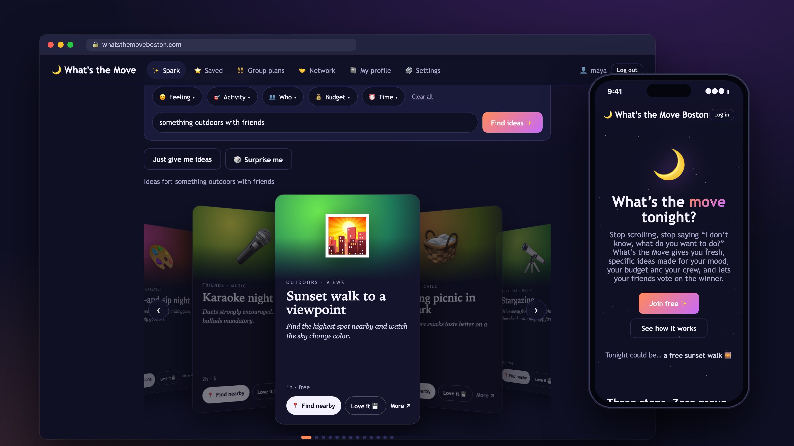

# What's the Move Boston

**Eight people, mostly beginners, one live app in 90 minutes**

**[Read the case study →](https://github.com/CB-viberrr/portfolio/blob/main/case-studies/whatsthemove.md)** · [Live](https://whatsthemoveboston.com)

- **Live before the team arrived:** the site was on its own domain 26 minutes before the first teammate's commit, so every save went straight to one shared URL, live in about 30 seconds.
- **Beginners pushed to `main` without breaking each other:** one owner per file, enforced by a Claude Code hook and a one-command save. 19 commits from 4 roles landed in the 90-minute window.
- **Hardened into a public product afterwards:** landing page, hashed sessions and lockout, a strict content security policy, and a $1-a-day AI budget.

---
This repository is a showcase: the code is private. A walkthrough or read access is available on request.
More work: [portfolio](https://github.com/CB-viberrr/portfolio) · © 2026 Charles Bingaman
